<p align="center">
  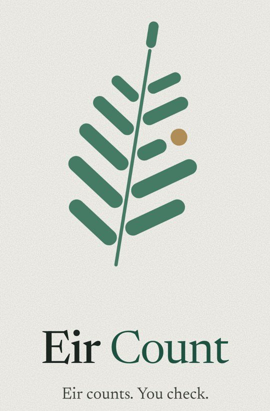
</p>

# Eir Count

**A phone app that counts pills in a pharmacy counting tray from a photo. Everything runs on the phone.**

Pharmacy staff count tablets and capsules by hand, five at a time, hundreds of times a day. Eir Count does the counting. The phone is held over the tray, it takes three photos, and it puts a dot on every pill. The pharmacist checks the dots and accepts the count. The tagline is the design rule: *Eir counts. You check.*

I'm a pharmacist. I designed and directed this project and built it with AI coding agents, mostly Claude Code, between September and November 2026. This repository is a showcase. It holds screenshots, results, design notes and a few representative source files. It does not hold the full app or the trained model.

<p align="center">
  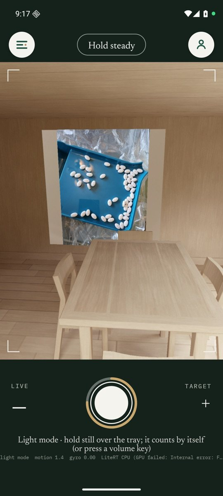
  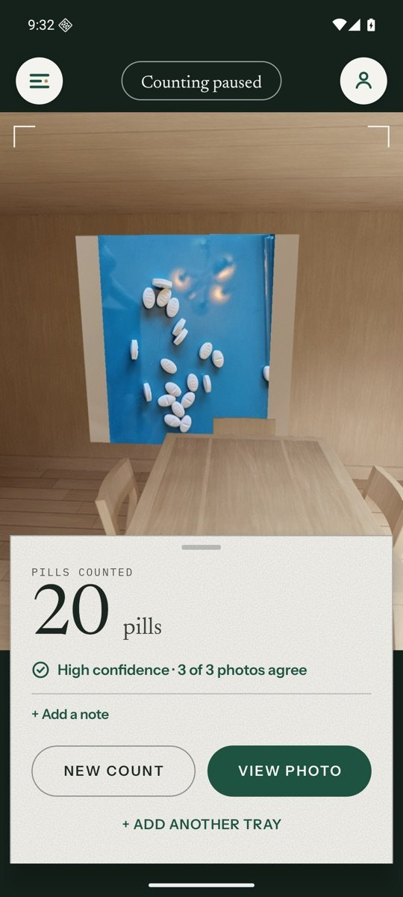
  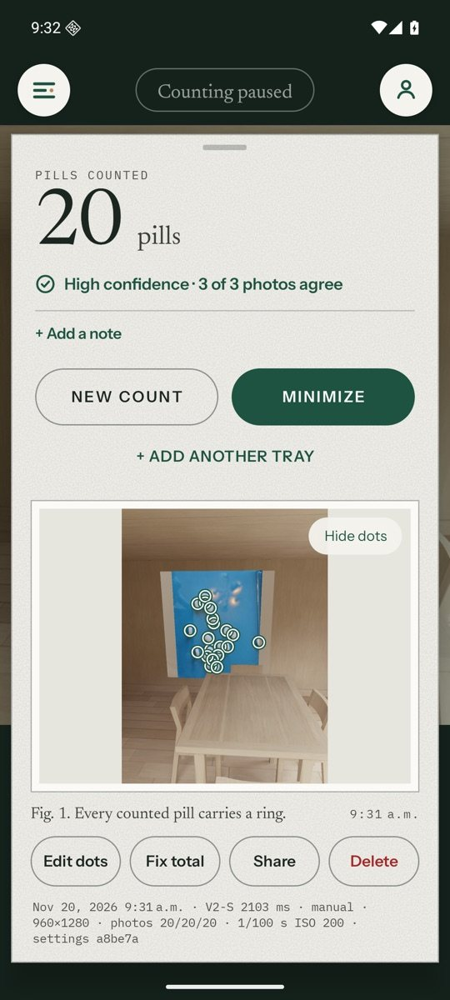
  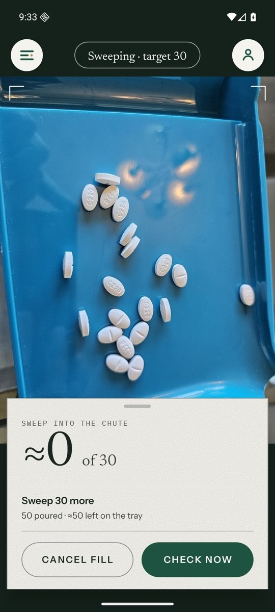
</p>

## What it does

- **Counts on the phone.** A neural network finds the centre of every pill and the edges of the tray. Only pills on the main tray surface count; the chute and anything outside the tray do not. Nothing is uploaded.
- **Never shows a percentage.** The app takes three photos and compares them. The result reads "High confidence · 3 of 3 photos agree" or "Please check".
- **Refuses bad photos.** A clearly blurred photo is not saved: the app says "Photo was blurred. Hold still." and takes another. Spots where pills may be stacked are circled, and the count is marked "Please check".
- **Lets the pharmacist correct it.** A dot can be added or removed with a tap. Every change is logged.
- **Fits pharmacy work:**
  - *Sweep to target:* pour, see how many are left over, sweep them into the chute.
  - Running totals across trays.
  - History with search and filters.
  - A PDF/CSV audit export.
  - Optional initials and Rx number on each count.
  - An alert when a different pill is mixed in.
- **Shares counts inside a pharmacy with no cloud.** Phones in the same store sync over the local Wi-Fi. A phone joins by scanning a QR code, and every message is encrypted.
- **Ships in English and French**, on Android and iPhone.

## Screens

| | | | |
|---|---|---|---|
| 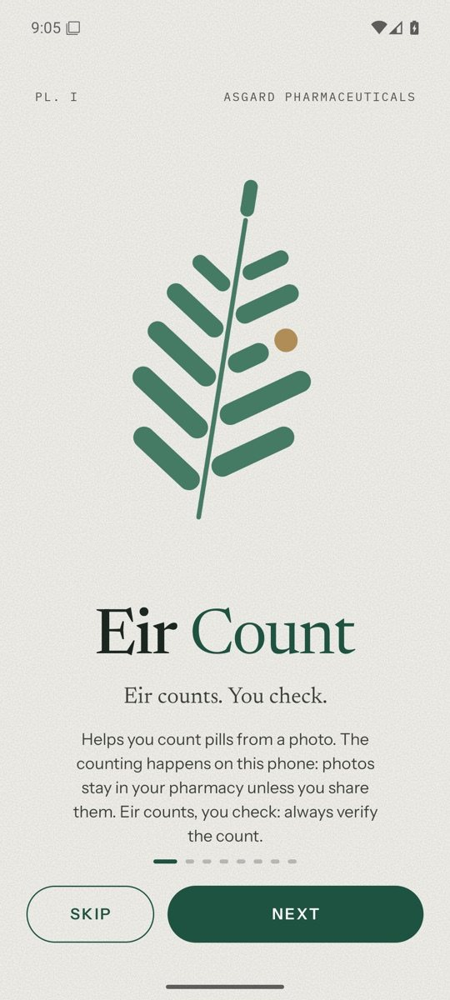 | 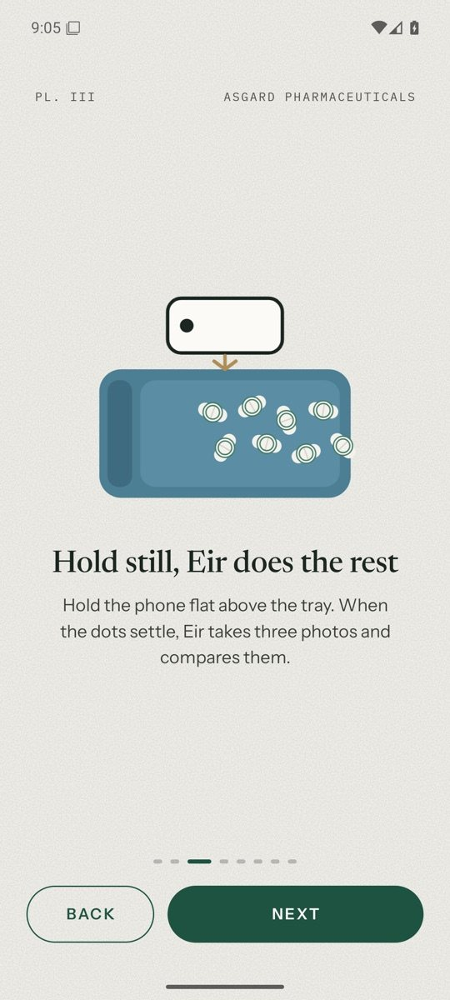 | 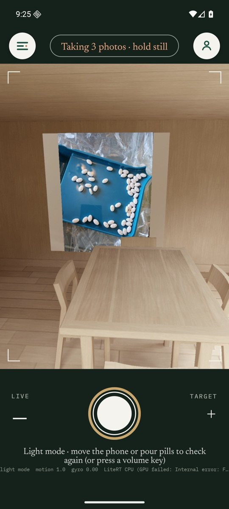 | 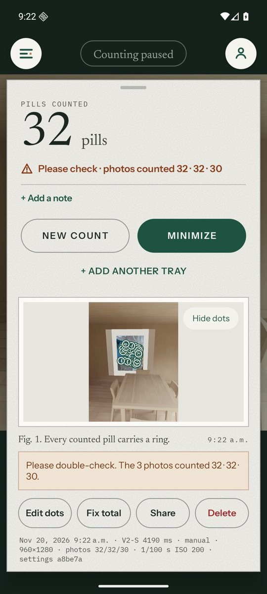 |
| Welcome | First-run guide | Taking three photos | A count the app is unsure of |
| 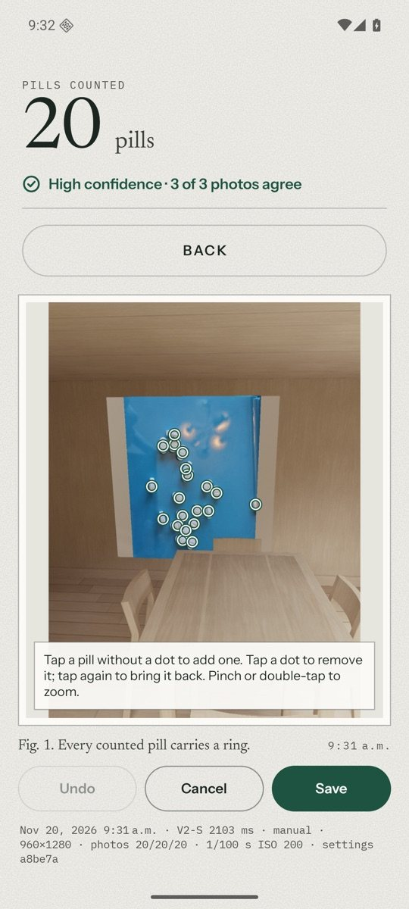 | 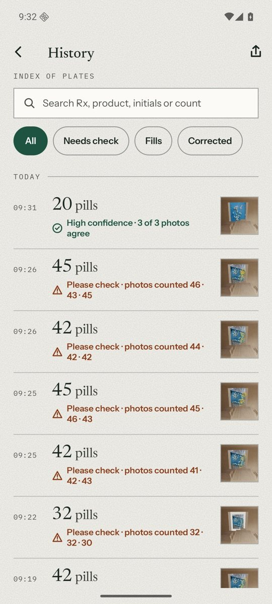 | 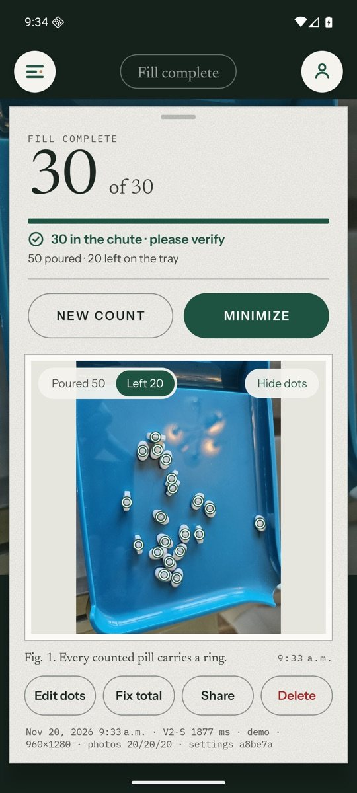 | 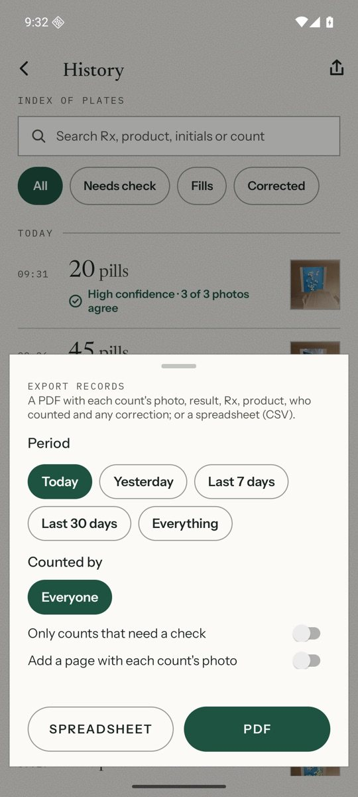 |
| Fixing dots by hand | History ("Index of plates") | Fill complete: poured and left photos | Audit export |
| 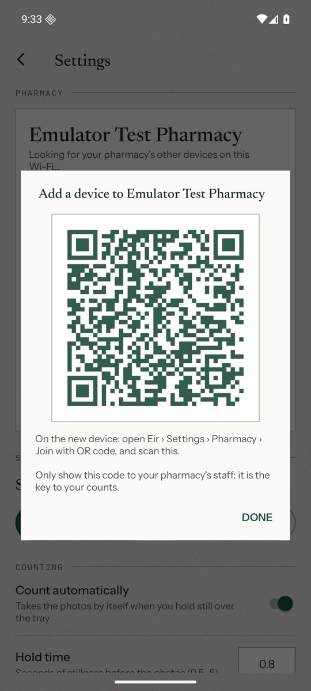 | 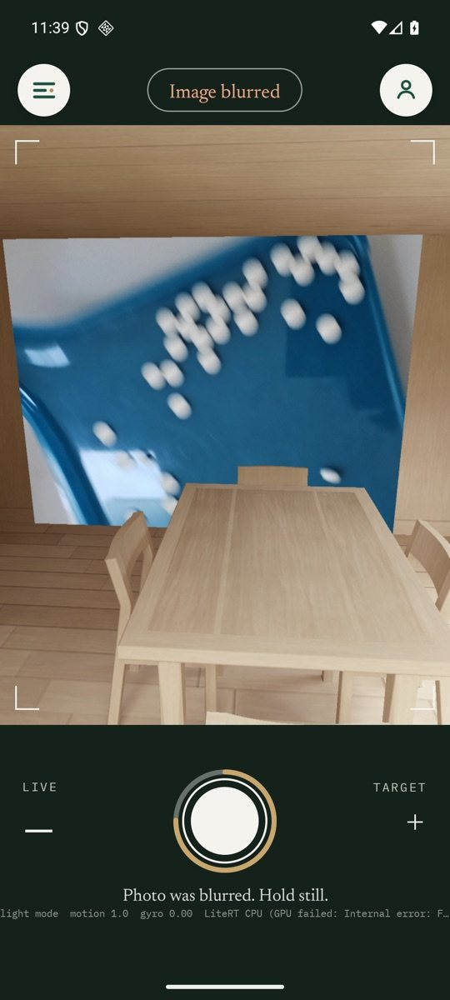 | 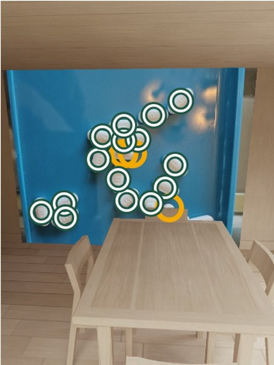 | 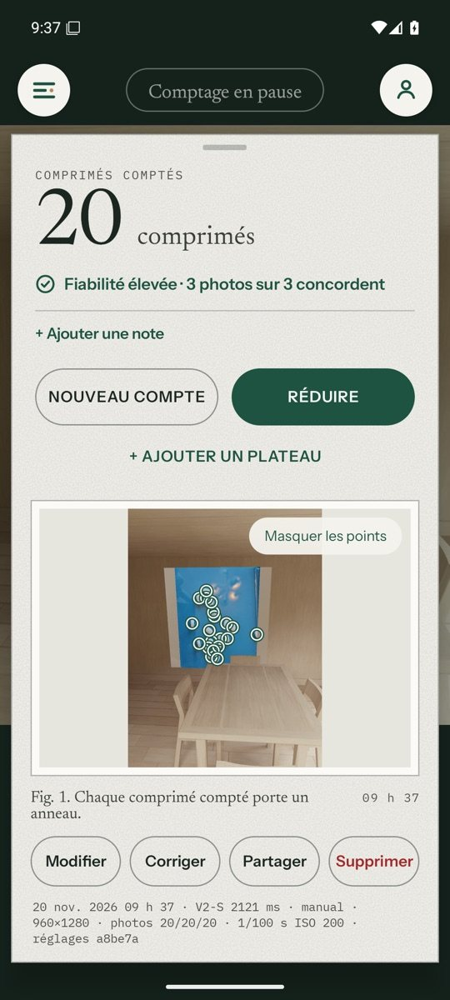 |
| Adding a phone to the pharmacy | Blurred photo refused | Possible overlaps circled | French |

These screenshots come from the Android emulator, whose camera looks at a tray photo hung in a virtual room; that is why the counts show a table and chairs. All screens are in [images/app/contact-sheet.jpg](images/app/contact-sheet.jpg). The look is described in [docs/design-style.md](docs/design-style.md).

## How it works

```
camera frame ──► EfficientNetV2-S + FPN ──► two 256×256 maps ──► decoder ──► dots + count
 (1024 px)       (on the phone's NPU/GPU)   · pill-centre heatmap   · peaks inside the tray
                                            · tray-surface mask     · capture checks
                                                                       (blur, overlap, weak dots)
3 photos ──► compare ──► "High confidence · 3 of 3 photos agree"  or  "Please check"
```

- **Android:** LiteRT. Snapdragon phones run the live preview on the Qualcomm NPU (about 40–46 ms a frame on a Galaxy S24). The photos that are actually counted run in full precision on the GPU, because the NPU's half-precision math was 1 pill off on some dense trays.
- **iPhone:** Core ML on the Neural Engine.
- **Slower phones:** the app times the model once per phone. Slow phones switch to a *light mode* that only counts when the phone is held still. A friend's Pixel 6 lagged so badly on an early build that they deleted the app; light mode came out of that report.

The full description is in [docs/how-it-works.md](docs/how-it-works.md).

## Results

- **Data:** the model was trained on about 870 real tray photos with every pill marked. The dots were proposed by software, then reviewed and corrected. Training also used thousands of photorealistic Blender renders, made to cover what real photos lacked: glare, hard shadows, trays the same colour as the pills, softgels and striped capsules.
- **Accuracy:** on 163 real photos never used in training, the current model counts **153 exactly** (about 94%). That figure uses the corrected answer key, explained below.
- **Remaining errors:** mostly capture problems, such as motion blur, stacked capsules and a pill cut off by the photo edge.
- **Warnings:** in a review of those photos, every wrong count also carried a warning sign (the warning rule was tuned on those same photos, so it still needs confirming on new ones). That led to the blur and overlap checks in the current build.

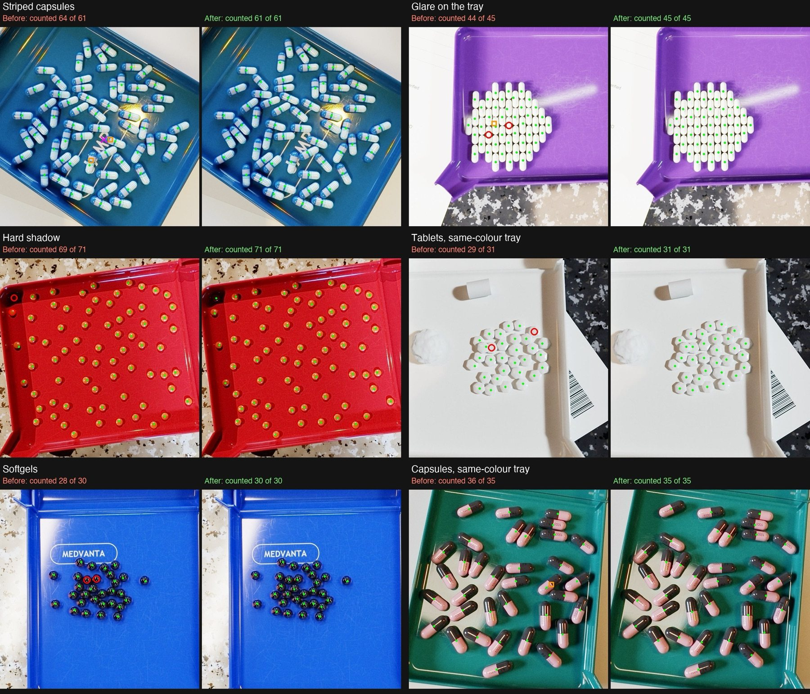

<sub>Hard rendered cases, previous model (left of each pair) and current model (right). Green dots are counted pills; red circles are misses; orange squares are extra dots.</sub>

**A finding about the test itself.** The real photos were labelled by correcting an early version of the app's own dots. That early app put two dots on some two-part printed capsules, one on each half, and 30 of those doubles survived review. The trained models do not reproduce them. They put one dot per capsule, so the test had been marking them wrong for being right. The lesson I took: benchmark truth should come from a known poured count, not from reviewing a model's dots. Details are in [docs/model-and-data.md](docs/model-and-data.md).

## Testing on real phones

- **Phone coverage:** I own one Android phone and one iPhone. Firebase Test Lab covered the rest: 13+ phones, from the Galaxy S22–S25 and Pixel 6–10 to Exynos, MediaTek and Tensor chips.
- **Scripted tests:** speed, NPU-vs-GPU parity on 109 verified photos, and a test that the phone's other apps stay smooth while Eir runs.
- **Spending cap:** Google's budgets only send emails, so the Test Lab runner script enforces a CAD $5/month cap itself. It refuses any run whose worst case would go over.
- **Automated tests:**
  - Android has 426 JVM unit tests.
  - The capture checks are written in Python first, then ported to Kotlin. Tests confirm the Kotlin version matches Python on 55 recorded test cases.
  - The iPhone app has its own test suite.

## A stand-alone counter (in design)

There is also a dedicated device: a tray under a camera arm, with a touch screen, built from 3D-printed parts and an off-the-shelf single-board computer. Four design directions were rendered, the "Ribbon" design was chosen, and printable parts and a parts list (about C$396) are ready. It has not been printed. On that board's NPU, an 8-bit version of the model counts badly, so the chip choice is still open. See [docs/hardware.md](docs/hardware.md).

<p align="center">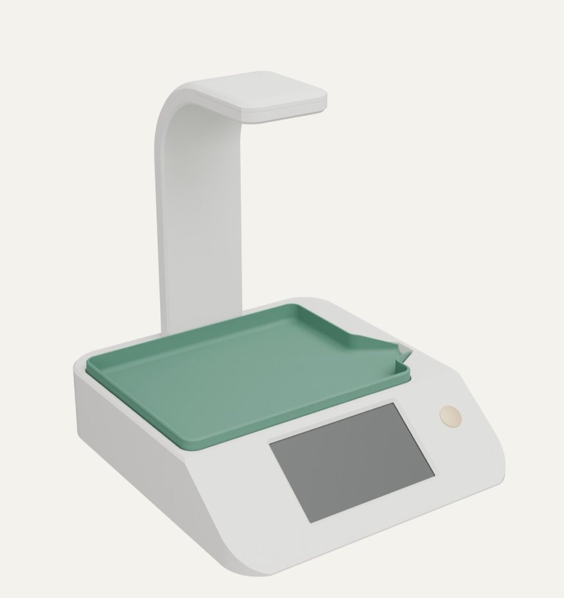</p>

## How it was built

Most of the engineering was done by Claude Code agents working under my direction. I set the product rules, labelled photos, made the decisions and tested on my own phone. Long handover notes kept context across sessions. Training ran on a remote GPU. Separate review agents audited the work before each release. [docs/building-with-claude.md](docs/building-with-claude.md) describes the workflow, what worked and what didn't.

**Size:** about 11,000 lines of Kotlin, 10,000 of Swift and 28,000 of Python (training, rendering, evaluation and tooling).

## Status (November 2026)

| | |
|---|---|
| Android | v0.19.1: new model, blur and overlap checks, redesigned look. Tested on the emulator and on my own phone; not yet in the Play Store. |
| iPhone | v0.18.2, at feature parity with the previous Android version. Redesign not yet ported. |
| Business | $5/month subscription with 14 days free; licences per pharmacy. Legal terms drafted, awaiting a lawyer's review. |
| Stand-alone device | Designed, not built. |

The app is a counting aid. The pharmacist verifies every count, and the app is built around that.

## In this repository

| Path | What |
|---|---|
| [docs/how-it-works.md](docs/how-it-works.md) | Model, decoder, phone engines, capture checks, sync |
| [docs/model-and-data.md](docs/model-and-data.md) | Data, renders, training rounds, results, the answer-key finding |
| [docs/hardware.md](docs/hardware.md) | The stand-alone counter |
| [docs/building-with-claude.md](docs/building-with-claude.md) | How the project was built with AI agents |
| [docs/design-style.md](docs/design-style.md) | The "specimen plate" visual style spec |
| [code-samples/](code-samples/) | Selected source files (Kotlin, Swift, Python) |
| [images/](images/) | Screenshots, model results, hardware renders |

© 2026 Asgard Pharmaceuticals. All rights reserved. Shared for viewing only; see [LICENSE](LICENSE).
