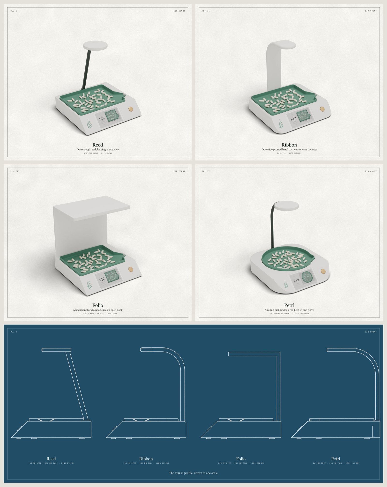
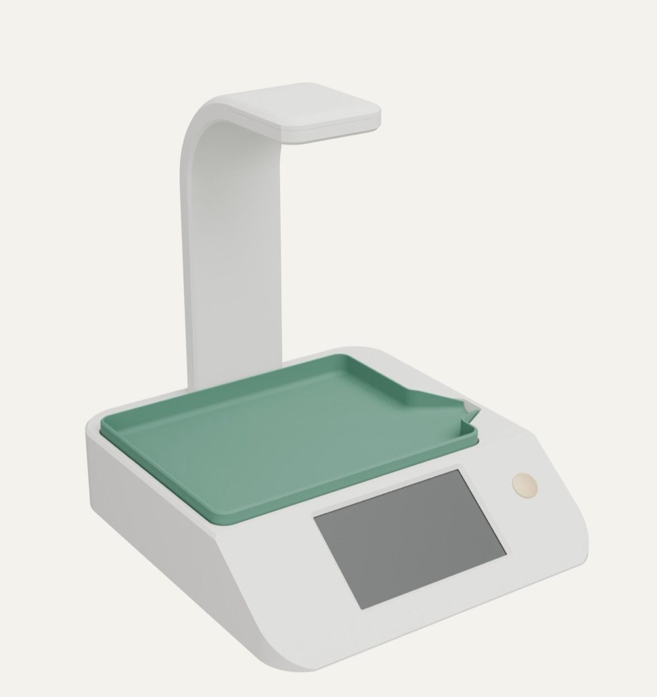
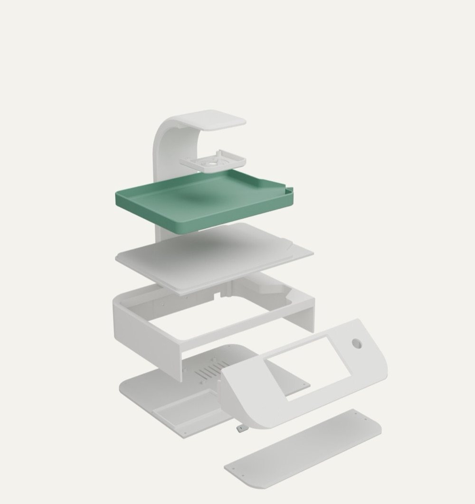
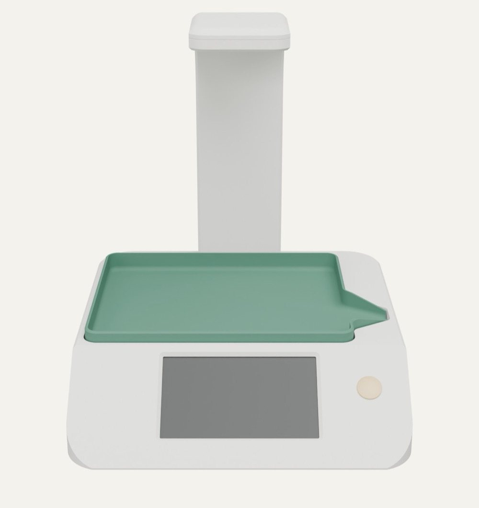

# The stand-alone counter (in design)

A phone works, but a busy pharmacy counter would benefit from a fixed device: a tray, a camera at a known height and a screen, always ready. The goals were affordable, fast, accurate, easy to clean, and buildable at home with a 3D printer, with no factory.

## Four directions

The design follows the same "specimen plate" style as the app: bone white, hemlock green, one brass button. Four directions were rendered at the same scale:

- **Reed:** one straight leaning rod and a disc. The simplest to build.
- **Ribbon:** one wide printed band curving over the tray. No metal, soft corners.
- **Folio:** a back panel and a hood. Shields the tray from stray light.
- **Petri:** a round dish under a curved rod. No corners to clean.

I picked **Ribbon**.

## Ribbon, ready to print

| Assembled | Exploded | Front |
|---|---|---|
|  |  |  |

- **Size:** 244 × 267 × 279 mm. The camera sits 213 mm above the tray floor.
- **Printed parts:** nine STL files. The band has a closed channel for the camera cable, and the camera sits in a screw-on cup at the tip.
- **Electronics:** a Radxa ROCK 3C single-board computer with a Rockchip NPU, a 5-inch 720 × 1280 touch screen, a Raspberry Pi camera, an LED ring and one brass "check" button.
- **Parts list:** about **C$396** before shipping and tax.
- **Reviews:** two independent design reviews were applied before the parts were finalised.

## The open question: can the chip run the model?

The model was converted for the board's NPU and tested in its simulator on 13 test images:

| Version | Exact counts |
|---|---|
| Original model (full precision) | 12 / 13 |
| Converted, 16-bit | 12 / 13, same as the original |
| Converted, 8-bit (standard calibration) | **0 / 13**, with large undercounts (47 → 15, 60 → 8) |
| Converted, 8-bit (alternative calibration) | 1 / 13, with overcounts |

The 16-bit conversion is correct, and the 8-bit one is what breaks. The fast 8-bit path is the one these NPUs are built for. Next steps are hybrid quantization, more calibration photos or quantization-aware training. Failing those, the 16-bit model would run on the board, and its speed there still has to be measured. Until one of these gives an accurate result on the real chip, the hardware choice is not proven.

Nothing has been printed or bought yet.
