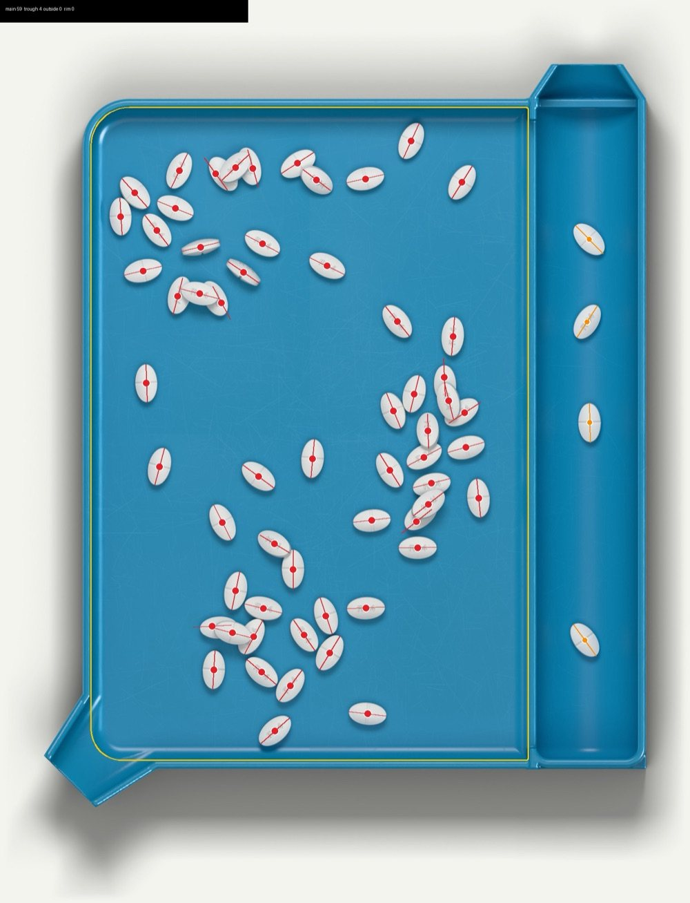

# How Eir Count works

## The counting rule

A pharmacy counting tray has a flat main surface and a chute (or trough) along one side. Eir counts **only the pills on the main surface**, one medication at a time. Pills in the chute, on the counter or in the user's hand are not counted. Excluding them is part of what the model learns. It is not a box drawn by the user.

A labelled render: red dots are pills on the main surface (59). Orange dots are in the trough (4) and are not counted.

## The model

- **Network:** an EfficientNetV2-S backbone, pretrained on ImageNet, with a small feature pyramid (128 channels) and a 3×3 head.
- **Input:** one 1024 × 1024 RGB image, letterboxed.
- **Output:** two maps at 256 × 256 (stride 4):
  1. a **pill-centre heatmap**, a Gaussian bump at the centre of each pill;
  2. a **tray-surface mask**, the main flat surface of the tray.
- **Size:** about 44 MB as a phone model.

This was the fifth model design. The first ones were tiny networks of about 1 million parameters. They stopped improving: every fine-tune landed within noise of where it started. The larger pretrained backbone was the biggest single jump, from 50 of 59 validation photos exact to 58 of 59. It also set a floor of Galaxy S22 / iPhone 13 class phones.

## The decoder

The decoder turns the two maps into dots. The same logic exists in Python, Kotlin and Swift, and tests check that all three versions agree.

1. Keep the **largest connected region** of the tray mask. This is the main surface; it drops the chute and stray tray-coloured areas.
2. Find **local maxima** of the centre heatmap, using a 3 × 3 peak window and a probability ≥ 0.3.
3. Keep the peaks that fall inside the tray region. Each kept peak is one pill.

See [code-samples/android/PillDecoder.kt](../code-samples/android/PillDecoder.kt) and [code-samples/ios/PillDecoder.swift](../code-samples/ios/PillDecoder.swift).

## Three photos, then a verdict

The camera watches for the phone to be held still over the tray, then takes a burst of three photos. Each photo is counted.

- If they agree, the result reads **"High confidence · 3 of 3 photos agree"**.
- If they disagree, or any check below fires, it reads **"Please check"**, and the spots that need looking at are circled.

The app never shows a percentage. A number like "97%" invites the wrong kind of trust.

## Capture checks (v0.19.1)

On 163 test photos, most of the model's remaining errors were capture problems, not model problems. So the current build checks the photo itself:

| Check | What happens | Evidence |
|---|---|---|
| **Clearly blurred** | The photo is refused. The app says "Photo was blurred. Hold still." and retakes it. After two retakes it saves the third as "Please check". | Separates blurred from sharp photos well (AUC 0.97); refused none of 358 sharp photos |
| **Borderline blur** | "Please check", with a line explaining why | Counts start drifting at this blur level on trays of 25+ pills |
| **Possible overlap** | The spot is circled, and the count says "Please check" | A stricter version ("spread the pills" before counting) would have held 7 of 21 *correct* dense photos, so it was not shipped |
| **Weak dot** | A dot the model is unsure of (score < 0.35) is circled | Caught two over-counts; flagged 1 of 95 correct photos |

**How blur is measured.** The check measures how wide pill edges are in their blurriest direction, as the median over up to 64 pills. A general sharpness score was not used, because it varies with how many pills are in the tray. The check was designed and tuned in Python on real and rendered photos, then ported to Kotlin. Tests confirm the Kotlin and Python results match on 55 recorded test cases.

Code: [BlurCheck.kt](../code-samples/android/BlurCheck.kt), [OverlapCheck.kt](../code-samples/android/OverlapCheck.kt), [CapturePolicy.kt](../code-samples/android/CapturePolicy.kt), and the Python reference [capture_checks.py](../code-samples/python/capture_checks.py).

## Running on many different phones

Phones differ a lot in what can run the model quickly:

| Phone type | Live preview | Counted photos |
|---|---|---|
| Snapdragon (Galaxy S22–S25 etc.) | Qualcomm NPU, half precision, about 40–125 ms a frame | GPU, full precision |
| Tensor, Exynos, MediaTek, Mali, PowerVR | *Light mode:* the model runs only when the phone is held still | GPU |
| iPhone 13 and newer | Core ML (Neural Engine) | Core ML |

- **Why counted photos use the GPU.** On 109 verified photos, the NPU was 3–4× faster but counted one extra pill on dense trays (55–87 pills) in 1–4 photos where the GPU was exact.
- **How each phone is sorted.** `DeviceTier` times the model once per phone and decides between full live dots and light mode. A slow timing that might be bad luck (a warm phone, battery saver) is timed again. An NPU slower than the GPU is dropped: one phone's NPU took 3.3 s a frame, its GPU 0.35 s. See [DeviceTier.kt](../code-samples/android/DeviceTier.kt).
- **A first-start fix found in Test Lab.** On a Pixel 6, setting up the GPU engine took 105 seconds on first launch, because the default setting tuned every GPU kernel exhaustively. Switching to quick tuning cut that to 3–6 seconds on three phones, with the same counts.
- **Proof the phone stays usable.** A Test Lab script measured the phone's own Settings app and notification shade while Eir counted nonstop for three minutes. Jank stayed the same or improved, with no thermal throttling.

## Pharmacy features

- **Sweep to target.** Enter the quantity on the prescription, pour, and Eir shows how many to sweep off. After the sweep a check photo confirms the result. The logic is pure and unit-tested: [Fill.kt](../code-samples/android/Fill.kt).
- **Running total.** Several trays can be added up for one large fill.
- **Dot editing.** Tap to add or remove a dot. Edits are logged and the count is marked as corrected.
- **History and audit export.** History can be searched and filtered, and exports as a PDF (with each count's photo) or a CSV.
- **Foreign pill alert.** The app flags a pill that looks different from the rest.
- **Store Wi-Fi sync, no cloud.**
  - A phone joins the pharmacy by scanning a QR code.
  - Phones find each other on the local network.
  - Requests are signed (HMAC) and answers are encrypted (AES-GCM).
  - An optional "home base" phone keeps everyone's counts when the others go home.
- **Privacy.** There are no accounts and no uploads. Photos are kept for a period the user chooses, from 2 weeks to forever, and counts are kept after their photos are deleted.

## What protecting the model taught me

The model is the product, so builds encrypt it inside the app. An outside security review of one build still recovered the exact model file. Encryption on the phone only stops casual copying, because the phone has to decrypt the model to run it. Real protection needs a key held on a server and released only to a genuine, subscribed install. That work is planned, not done.
