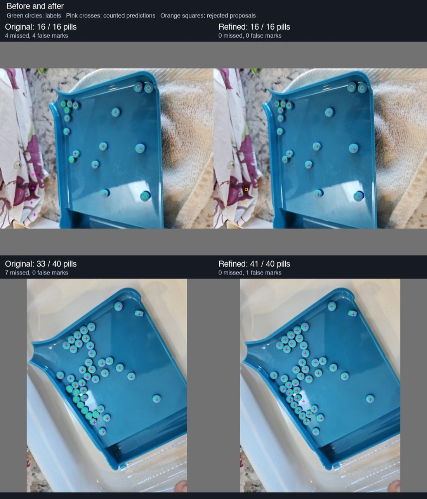
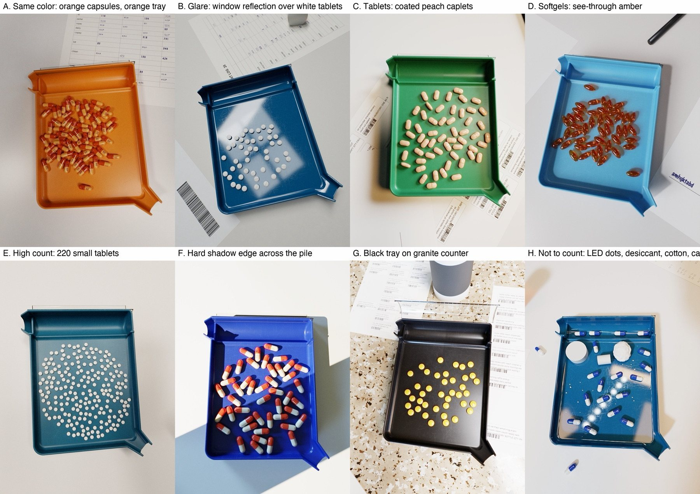
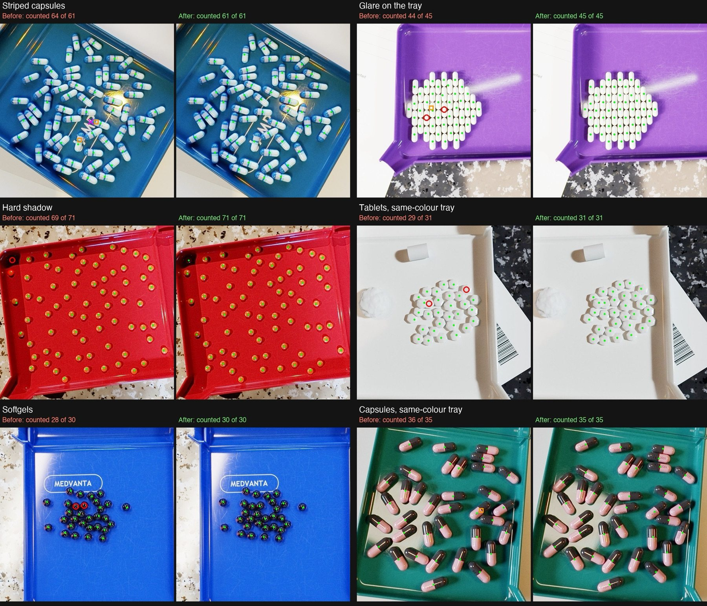
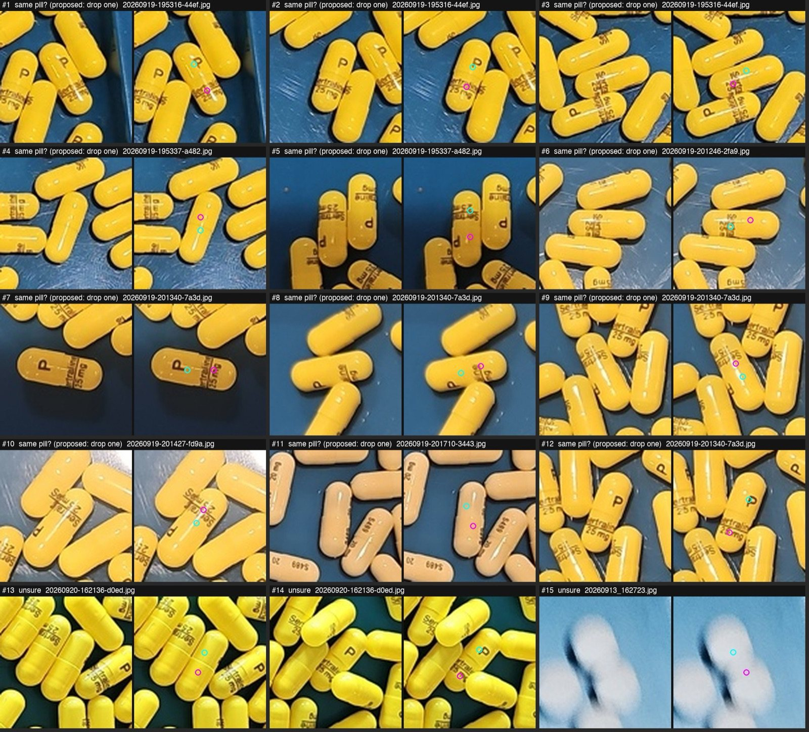

# Model and data

## Where it started (September 13, 2026)

The first data was about a thousand phone photos of one blue counting tray. The first model was small, and the first comparison already showed the two problems that would matter for the rest of the project. One was missing pills that touch. The other was counting things that are not pills, here four marks on a patterned towel beside the tray.

An early model, September 2026. Green circles are labels; pink crosses are counted dots.

## Labels and how they were kept honest

- **Labels are a dot per pill**, at its centre, in the photo's true orientation.
- **Most dots were proposed by software.** An assistant or an earlier model placed them, and every one was then reviewed in a desktop tool. Each label records who placed it and whether a person reviewed it. Training refuses assistant labels that have not passed a second-pass audit.
- **Test photos are never seen in training.** 163 real photos are held out, the trainer checks this, and the model chosen for release is scored on them once.

## Photorealistic renders

Real photos all came from one tray, a few backgrounds and mostly one kind of light. Measured weak spots of the model:

- **grain noise:** 4 of 21 exact, down from 16;
- **motion blur:** 64 of 104, down from 88;
- **strong glare:** 74 of 104;
- **a tray the same colour as the pills:** 76 of 104;
- **very small pills:** pills of 4 mm or less were mostly missed.

To cover these, a Blender pipeline renders pharmacy trays with exact labels:

- **Tray:** a parametric counting tray in many colours, from the same colour as the pills to black, white or clear.
- **Pills:** capsules, including striped, banded and bead-filled ones, plus tablets, caplets and softgels, with stamped codes on them.
- **Placement:** pills are dropped into the tray with physics, so they pile and touch like real ones.
- **Scene:** window glare, hard shadows, granite, steel and wood counters, and paperwork with barcodes.
- **Things not to count:** cotton, desiccant packs and bottle caps.
- **Camera:** each scene is rendered twice, once clean and once "badly shot" with phone-camera noise and blur.

One example per render family: same-colour tray, glare, coated caplets, see-through softgels, a high count, hard shadow, black tray on granite, and things that should not be counted.

The current round used **2,321 scenes (4,642 images)**, rendered on a remote RTX 5090. Before training, the renders were checked for realism. In a blind test, a reviewing model judged crops of the capsule renders "real" in 12 of 12 and 10 of 12 cases. Images from an image-generation model, tried as an alternative, were judged real in 0 of 12.

Render script: [code-samples/python/render_v3.py](../code-samples/python/render_v3.py).

## Training rounds

| Round | What changed | Result |
|---|---|---|
| v1–v4 | Small custom networks (about 1M parameters) | Stopped improving: every fine-tune landed within noise |
| v5 | EfficientNetV2-S backbone at 1024 px | Validation 50 → 58 of 59 exact. The biggest single jump |
| Rounds 04–05 | First capsule renders mixed in; new phone captures; an extra output that refines each dot's position | Render-trained models halved the error on held-out photos |
| **Round 06** | New render families, camera-damage augmentation (grain, blur, glare, tray recolouring), negatives | Below |

- **Round 06 recipe:** continue from round 05 with real photos as the main signal, renders as a minority of each batch, and the old model as a teacher so it doesn't forget what it already does well.
- **Seeds:** three, so that a release is not one lucky run.
- **Checkpoint choice:** made on validation photos and held-out renders only. The 163 test photos were scored once, on the chosen checkpoint.

Training script for the v5 model line: [code-samples/python/train_v5.py](../code-samples/python/train_v5.py).

## Results on 163 real test photos

| Model | Exact counts | With the corrected answer key |
|---|---|---|
| Round 05 (previous app) | 146 | 152 |
| **Round 06 (current app)** | **149** | **153 (about 94%)** |

Where round 06 is clearly better:

- **dim photos:** 64 of 104 exact (round 05: 0);
- **real counts a tester had corrected:** 6 of 10 right (round 05: 3);
- **held-out renders:** 42% fewer pills miscounted.

**On the phone itself** (Galaxy S23 Ultra, 109 verified photos), round 06 counted 100 exactly on the GPU in full precision and 97 on the NPU in half precision. The two engines gave the same count on 106 of the 109.

## The answer key was wrong in a specific way

Many real photos were labelled by correcting an early version of the app's dots. That early app sometimes put **two dots on one two-part capsule**, one on each printed half. Thirty of those doubles survived review: 12 in the test set and 18 in training.

The trained models do not repeat the mistake. They put one dot on each capsule, so the test had been scoring them as wrong when they were right. I reviewed the pairs below and confirmed them, and the corrected key adds 4–6 exact photos to each model.

Each pair shows the photo and then the old label's two dots on one capsule. Tiles 13–15 were marked "unsure" for review.

Lesson: the true count for a benchmark photo should come from a **known poured number**, not from reviewing dots, especially dots a model proposed.

## What is still wrong

About 10 of 163 photos are still wrong. The causes are motion blur (3), stacked or tightly touching capsules (2), an extra dot (3, one of them on glare), a pill cut off by the photo edge (1) and one photo whose label is debatable (1).

More renders and more training of this kind did not close the gap. Four seeds and three recipe changes all landed within one photo of each other. Since the remaining errors are capture problems, the next step was in the app: refuse blurred photos and circle possible overlaps ([how-it-works.md](how-it-works.md#capture-checks-v0191)).

**A warning rule** that combines a weak dot, a near-miss peak and a count that changes under small noise caught all 10 wrong counts. It also flags 25% of correct ones, which is too many. The rule was also tuned on these same photos, so it needs confirming on new ones.
